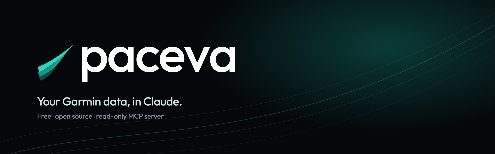

<p align="center"></p>

# Paceva for Garmin

Ask Claude, ChatGPT or any MCP app about your own Garmin data: sleep, HRV, Body Battery, stress, resting heart rate, steps and activities.

> "How did I sleep last night?"
> "Is my HRV trending down this month?"
> "Compare my last three long runs."
> "What could I run a half marathon in right now?"

**Free, open source and local.** It runs on your computer with your own [Garmin Personal API key](https://connect.garmin.com/app/settings/personalApiToken). Your data goes from Garmin to your computer to your AI app, and never through anyone else's server. It's read-only: it can't change anything in Garmin Connect.

## 1. Get a Garmin Personal API key

1. Open [Garmin Connect › Personal API Key](https://connect.garmin.com/app/settings/personalApiToken), signed in.
2. Select **Create Key**, accept the terms and choose how long it lasts (up to a year).
3. Copy the key. Garmin shows it only once.

## 2. Add it to your AI app

### Claude Desktop (easiest)

Download **[paceva-garmin.mcpb](https://paceva.app/download/paceva-garmin.mcpb)**, double-click it, and paste your key when Claude asks. That's it.

### Everything else

These need [Node.js](https://nodejs.org) 20 or newer. First save your key (it's hidden as you paste and checked with Garmin):

```sh
npx github:OwenScheuer/paceva-garmin-mcp setup
```

Then add the server:

**Claude Code**

```sh
claude mcp add garmin -- npx -y github:OwenScheuer/paceva-garmin-mcp
```

**Cursor, VS Code, Windsurf, Claude Desktop (manual) and others:** add to the app's MCP servers:

```json
{
  "mcpServers": {
    "garmin": { "command": "npx", "args": ["-y", "github:OwenScheuer/paceva-garmin-mcp"] }
  }
}
```

**ChatGPT** only connects to remote servers over the internet, not to local ones, so it can't use this yet.

To check your key at any time: `npx github:OwenScheuer/paceva-garmin-mcp check`.

## What it can read

| Tool | What it gives your AI |
| --- | --- |
| `get_daily_overview` | One day at a glance: summary, sleep, HRV and Body Battery |
| `get_daily_summaries` | Steps, calories, resting HR, stress and intensity minutes per day |
| `get_sleep` | One night in detail, or nightly summaries over a range |
| `get_hrv` | Overnight HRV, baseline and status |
| `get_body_battery` | Charged, drained, high and low |
| `get_stress` · `get_steps` · `get_heart_rate` · `get_spo2` | Daily stress, steps, heart rate and Pulse Ox |
| `get_training_log` | Every activity in a period (up to a year) with Garmin's main fields: distance, time, speed, heart rate, power, TSS, fastest splits, time in zones |
| `list_activities` · `get_activity` | Your activities, and any one in full |
| `get_profile` | Profile settings and heart rate zones |
| `get_weight` · `get_fitness_age` · `get_hydration` · `get_food_log` · `get_menstrual_cycle` | The rest of what Garmin's Personal API offers |

**Just Garmin's data.** No scores, models or advice are added: every number is Garmin's, in Garmin's own field names and units. Ask "what could I run a 10K in?" and any prediction is your AI's own, made from that data.

Ranges are capped at 92 days per call (a year for the training log). Minute-by-minute series (heart rate through the day, sleep stages) come back as a count, min, max and average unless your AI asks for the full series.

Garmin's Personal API doesn't include training readiness, training status or recovery time, so neither does this.

## Your key and your privacy

- Your key is saved to `~/.config/garmin/connect-personal-api-key`, the same place Garmin's own tools look, readable only by you. You can also set `GARMIN_PERSONAL_API_KEY` instead.
- The short-lived access token Garmin issues is cached in `~/.config/paceva-garmin/token.json`, also readable only by you.
- The data your AI app reads is sent to that app's provider (for example Anthropic or OpenAI) as part of your chat, under their privacy terms.
- To revoke access, delete the key in Garmin Connect.

Garmin's Personal API is for your own data. Each person uses their own key; please don't build a service that collects other people's keys.

## Troubleshooting

- **"Garmin didn't accept your Personal API key"**: it expired or was deleted. Make a new one, then run `npx github:OwenScheuer/paceva-garmin-mcp setup` again. (For the Claude Desktop extension, update the key in Settings › Extensions.)
- **"No Garmin Personal API key found"**: run `npx github:OwenScheuer/paceva-garmin-mcp setup`.
- **"Garmin is rate-limiting requests"**: wait a minute and ask again.

## Development

```sh
npm install
npm test
npm run build
./scripts/pack-mcpb.sh   # builds paceva-garmin.mcpb
```

Not affiliated with or endorsed by Garmin. Garmin and Garmin Connect are trademarks of Garmin Ltd. or its subsidiaries.

MIT licensed. Made by [Paceva](https://paceva.app).
